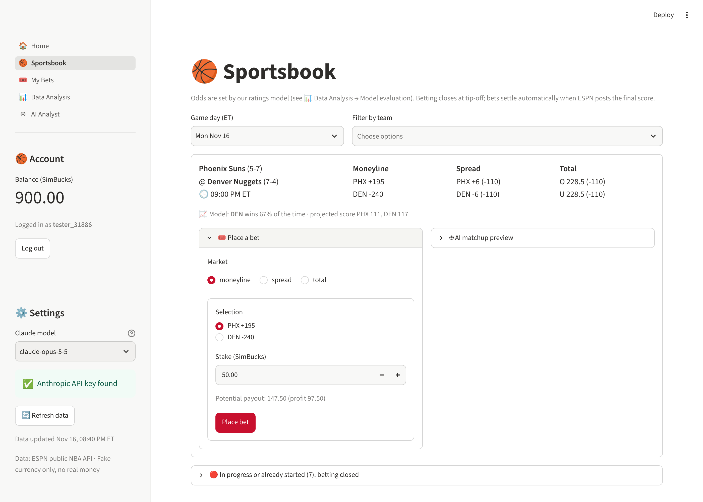
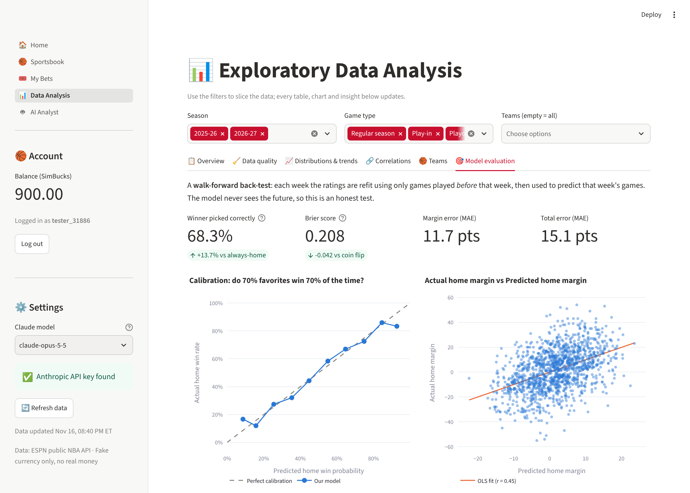

# 🏀 NBA Mock Sportsbook

A Streamlit web app where users bet **fake currency ("SimBucks")** on **real upcoming NBA games**.
Betting lines come from **our own statistical model**, built on live data from the ESPN API. The app
includes a full **exploratory data analysis (EDA)**, and an **LLM (Claude, via the Anthropic API)**
writes reports, explains charts, previews games, and answers questions about the data.

> Masters of Data Science · Programming for Data Science · Final project.
> **No real money is involved at any point.**

---

## Table of contents
1. [Project purpose & overview](#1-project-purpose--overview)
2. [Setup & installation](#2-setup--installation)
3. [How to run the Streamlit app](#3-how-to-run-the-streamlit-app)
4. [API & data source details](#4-api--data-source-details)
5. [Methodology & results](#5-methodology--results)
6. [Project structure](#6-project-structure)
7. [Testing & code quality](#7-testing--code-quality)
8. [Rubric checklist](#8-rubric-checklist)
9. [Team & collaboration](#9-team--collaboration)
10. [Troubleshooting](#10-troubleshooting)

---

## 1. Project purpose & overview

A sportsbook is a real-world data-science product: it turns historical data into probabilities,
then into prices. This project rebuilds that pipeline end to end:

| Step | What happens | Code |
|---|---|---|
| **Acquire** | Download every NBA game from 2025-26 and 2026-27 from the ESPN API | `src/data_fetcher.py`, `src/data_service.py` |
| **Store** | Cache games, users and bets in SQLite; ship a CSV snapshot for offline use | `src/database.py`, `data/games_snapshot.csv` |
| **Clean & explore** | Missing data, outliers, distributions, trends, correlations | `src/eda.py`, `views/data_analysis.py` |
| **Model** | Team power ratings (weighted ridge regression) → win probabilities → odds | `src/odds_model.py` |
| **Evaluate** | Walk-forward back-test: accuracy, Brier score, calibration | `src/odds_model.py::backtest` |
| **Bet** | Moneyline / spread / total bets; auto-settled from final scores | `src/betting.py`, `views/sportsbook.py` |
| **LLM** | AI EDA report, "explain this chart", game previews, analyst chatbot | `src/llm.py`, `views/ai_analyst.py` |

### App pages
| Page | What you can do |
|---|---|
| 🏠 **Home** | Overview, next games with odds, top power ratings, how-to guide |
| 🏀 **Sportsbook** | Pick a game day and team, see model odds, place bets, get an AI matchup preview |
| 🎟️ **My Bets** | Open/settled bets, W-L-P record, ROI, cumulative profit chart, leaderboard |
| 📊 **Data Analysis** | Interactive EDA with season, game-type and team filters, plus model evaluation and "🤖 Explain this with AI" |
| 🤖 **AI Analyst** | AI-written EDA report (downloadable) and a chatbot that knows the app's data and your bets |



---

## 2. Setup & installation

**Requirements:** Python 3.10+ and an internet connection (for live data and the AI features).

```bash
git clone https://github.com/<your-team>/nba-sportsbook.git
cd nba-sportsbook
python -m venv .venv
source .venv/bin/activate            # Windows: .venv\Scripts\activate
pip install -r requirements.txt
```

### Add your Anthropic API key (enables the AI features)
1. Create a key at <https://console.anthropic.com> (*API Keys → Create key*).
2. Copy the example secrets file and paste in your key:
   ```bash
   cp .streamlit/secrets.toml.example .streamlit/secrets.toml
   # then edit .streamlit/secrets.toml:  ANTHROPIC_API_KEY = "sk-ant-..."
   ```
   On Windows: `copy .streamlit\secrets.toml.example .streamlit\secrets.toml`.
   You can also `export ANTHROPIC_API_KEY=sk-ant-...` instead.

`secrets.toml` is git-ignored, so the key is never committed. **Without a key the app still works**;
only the AI features are disabled, and they show setup instructions instead.

---

## 3. How to run the Streamlit app

```bash
streamlit run app.py
```
Open <http://localhost:8501>. On first launch the app downloads about 1,800 games from ESPN (about 15 seconds)
and caches them in `data/sportsbook.db`. After that it only re-fetches the current month and the next
week, at most every 30 minutes or when you click **🔄 Refresh data** in the sidebar.

**Offline?** If ESPN can't be reached, the app loads `data/games_snapshot.csv` and shows a
"ESPN unreachable" notice in the sidebar, so the demo still works.

### Deploy to Streamlit Community Cloud (optional, free)
1. Push this repo to GitHub.
2. Go to <https://share.streamlit.io> → **Create app** → choose the repo, branch `main`, main file `app.py`.
3. Under **Advanced settings → Secrets**, paste `ANTHROPIC_API_KEY = "sk-ant-..."`.

Note: on Streamlit Cloud the SQLite file resets whenever the app restarts, so bets don't persist forever there.

---

## 4. API & data source details

### ESPN NBA scoreboard API (the data)
| | |
|---|---|
| Endpoint | `https://site.api.espn.com/apis/site/v2/sports/basketball/nba/scoreboard` |
| Auth | None (free, public, unofficial) |
| Format | **JSON** |
| Queries | `?dates=YYYYMM&limit=500` (one month of games), `?dates=YYYYMMDD` (one day) |
| Coverage | 2025-26 season (incl. play-in and playoffs), 2026-27 season to date, next 7 days of schedule |

Response structure (trimmed to the fields we use):
```json
{"events": [{
  "id": "401909993",
  "date": "2026-11-16T03:00Z",
  "season": {"year": 2027, "slug": "regular-season"},
  "status": {"type": {"name": "STATUS_FINAL", "completed": true}},
  "competitions": [{
    "neutralSite": false, "attendance": 18236, "venue": {"fullName": "..."},
    "competitors": [{
      "homeAway": "home", "score": "103", "winner": false,
      "team": {"abbreviation": "SAC", "displayName": "Sacramento Kings"},
      "statistics": [{"name": "rebounds", "displayValue": "37"}, {"name": "fieldGoalPct", "displayValue": "45.1"}],
      "records": [{"type": "total", "summary": "1-12"}]
    }, {"homeAway": "away", "...": "..."}]
  }]
}]}
```
**Processing:** each event is flattened into **one row per game** (43 columns: `home_*` / `away_*` score,
points, rebounds, assists, FG / 3PT / FT made, attempted and %, plus record). For the analysis it is
reshaped to **one row per team per game**.

**Cleaning:** we remove preseason games and the **All-Star Game**, which ESPN labels as regular season.
Our missing-data check flagged it because those games have no box scores. Postponed games
(`STATUS_POSTPONED`) are kept out of the analysis, and bets on them are voided and refunded.

### Anthropic Claude API (the LLM)
| | |
|---|---|
| SDK | `anthropic` (official Python SDK), streaming responses |
| Default model | `claude-opus-5-5` (switchable in the sidebar: Opus / Sonnet / Haiku / custom ID) |
| Grounding | Each prompt includes JSON computed by the app; the system prompt tells Claude to cite only those numbers |
| Features | (1) AI EDA report, (2) "Explain this with AI" on outliers, correlations and model evaluation, (3) game previews comparing model probability vs. price, (4) analyst chatbot with conversation history |
| Robustness | Clear messages for a missing or invalid key, unknown model, rate limits, server and network errors, refusals and truncation; automatic retry with a simpler request if newer API options are rejected |

---

## 5. Methodology & results

**Power ratings.** We fit `margin = HCA·home + rating_home − rating_away` using weighted ridge
regression (λ = 2). Weights decay with a 45-day half-life, and last season's games count at 35%. A
second regression splits teams into offense (points scored) and defense (points allowed) for totals.

**Odds.** `P(home win) = Φ(predicted margin / σ)`, with σ ≈ 13.4 points (the model's error spread).
Moneylines include a 4.5% house margin; spreads and totals are priced at -110.

**Key EDA findings** (1,519 completed games):
- **Home-court advantage:** home teams win **55.0%**, by **+1.75 pts** on average. Controlling for team strength, the model estimates **+2.3 pts**.
- **Efficiency beats volume:** FG% has the strongest correlation with winning (**r = 0.47**). 3-point *attempts* have none (**r = −0.01**), while 3PT % does (**r = 0.34**).
- **Playoffs are lower scoring:** about **216** total points vs **231** in the regular season.
- **Totals are noisy:** standard deviation of about **20 points**, so over/unders are close to coin flips.

**Model evaluation** (walk-forward back-test, 1,363 games, never trained on future data):

| Metric | Our model | Baseline |
|---|---|---|
| Winner accuracy | **68.3%** | 54.6% (always pick home) |
| Brier score | **0.208** | 0.250 (coin flip) |
| Margin MAE | **11.7 pts** | n/a |

The calibration curve tracks the diagonal: teams given a 70% chance win about 70% of the time.



---

## 6. Project structure
```
nba-sportsbook/
├── app.py                    # entry point + page navigation
├── views/                    # one file per page (UI only)
│   ├── home.py  sportsbook.py  my_bets.py  data_analysis.py  ai_analyst.py
├── src/                      # logic (no Streamlit except ui.py), unit-tested
│   ├── data_fetcher.py       # ESPN API calls + JSON parsing
│   ├── data_service.py       # refresh/caching logic, data cleaning, offline snapshot
│   ├── database.py           # SQLite schema + queries
│   ├── eda.py                # EDA functions (pure pandas)
│   ├── odds_model.py         # ratings, odds math, back-test
│   ├── betting.py            # place / grade / settle / void bets
│   ├── llm.py                # Claude API integration + prompts
│   ├── charts.py             # Plotly chart builders (one consistent palette)
│   └── ui.py                 # shared Streamlit helpers (sidebar, caching, streaming)
├── tests/                    # pytest suite (34 tests; no network or API key needed)
├── data/games_snapshot.csv   # offline data snapshot
├── docs/                     # report, presentation plan, team workflow, screenshots
├── .github/workflows/ci.yml  # GitHub Actions: lint + tests on every push / PR
├── pyproject.toml            # ruff (lint) + pytest config
└── requirements.txt
```

---

## 7. Testing & code quality
```bash
pytest -q          # 34 unit tests: odds math, bet grading/settlement/voiding, JSON parsing,
                   # model recovers known team strengths, EDA helpers, LLM prompts & error handling
pip install ruff
ruff check .       # lint (style, imports, common bugs)
```
GitHub Actions runs both on every push and pull request (`.github/workflows/ci.yml`).
The LLM tests use a fake client, so they need no API key and cost nothing.

---

## 8. Rubric checklist

| Requirement | Where it's met |
|---|---|
| Connect to an external API for real data | ESPN API, `src/data_fetcher.py` |
| Document source and structure (JSON) | Section 4 above; *Data Analysis → Overview → Data source* |
| Data retrieval and storage logic | `src/data_service.py` (incremental refresh), `src/database.py` (SQLite) |
| Descriptive statistics and visualizations | *Data Analysis → Distributions & trends* |
| Outliers and missing data: identify and treat | *Data Analysis → Data quality* (IQR, winsorizing; All-Star and postponed games) |
| Correlation analysis | *Data Analysis → Correlations* (Pearson/Spearman heatmap, scatter + fit) |
| Insights shown in the app | *Overview → Key insights*, playoff insight, model evaluation |
| LLM via API, used meaningfully | `src/llm.py`: report, chart explanations, previews, chatbot |
| Clean UI; users can filter, visualize and query | Filters on Sportsbook and EDA pages; chatbot for natural-language queries |
| Error handling, documentation, user guidance | Friendly errors everywhere, offline fallback, how-to on Home, tooltips |
| Modular, documented, readable code | `src/` vs `views/` split, docstrings, ruff lint |
| Git/GitHub with commits from each member | See section 9 and `docs/TEAM_WORKFLOW.md` |
| README: purpose, setup, API, how to run | This file |
| Report (2–3 pages, screenshots) | `docs/Project_Report.docx` |
| Presentation / demo | `docs/PRESENTATION.md` |

---

## 9. Team & collaboration
| Member | Main responsibilities |
|---|---|
| _Name 1_ | Data acquisition, database, data cleaning |
| _Name 2_ | EDA & visualizations |
| _Name 3_ | Odds model, back-test & betting engine |
| _Name 4_ | LLM integration & Streamlit UI |

We worked on feature branches and merged through reviewed pull requests, with CI checking every PR.
See `docs/TEAM_WORKFLOW.md`.

---

## 10. Troubleshooting
| Problem | Fix |
|---|---|
| `streamlit: command not found` | Activate the virtual environment first (`source .venv/bin/activate`) |
| Sidebar says "No Anthropic API key" | Create `.streamlit/secrets.toml` (section 2) and restart the app |
| "API key was rejected" | Check for typos or extra spaces in the key; make sure the key is active in the Anthropic Console |
| "Model not found / no access" | Pick another model in the sidebar (e.g. `claude-sonnet-5-5`) |
| Sidebar says "ESPN unreachable" | No internet: the app is using the saved snapshot. Click **🔄 Refresh data** once you're online |
| Strange error after editing code | Stop the app (`Ctrl+C`) and start it again |
| Want a clean slate | Stop the app and delete `data/sportsbook.db`; it rebuilds on the next launch |
